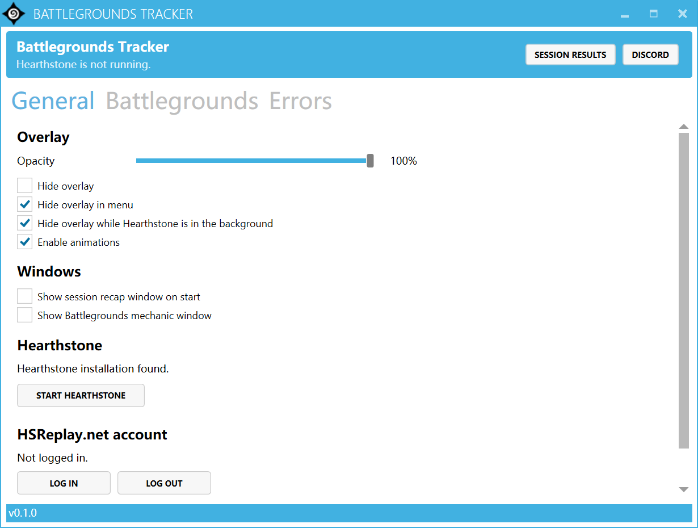
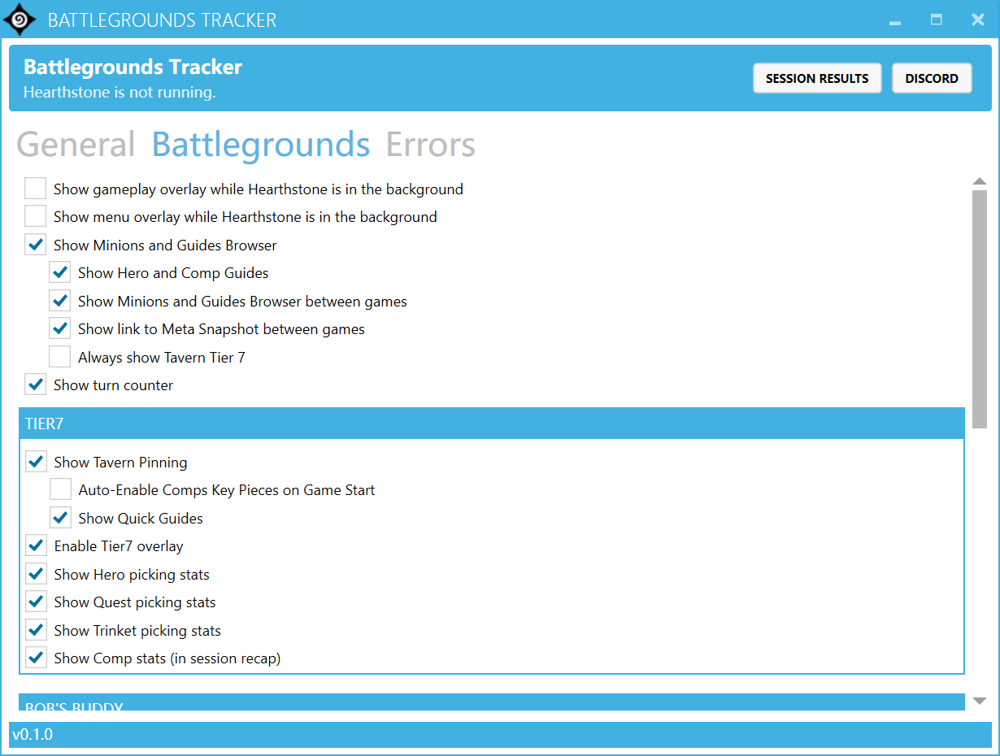

# Battlegrounds Tracker

**English** | [中文](#中文)

A Battlegrounds-only fork of [Hearthstone Deck Tracker](https://github.com/HearthSim/Hearthstone-Deck-Tracker).
It keeps the Battlegrounds overlays and Bob's Buddy combat simulator, and removes the deck tracker,
statistics, arena, mercenaries, replays, plugins and the auto updater.


---

## English

### What is this?

Battlegrounds Tracker reads Hearthstone's log (and HearthMirror game state) and shows information
that matters in a Battlegrounds match. It is a slimmed-down, standalone extraction of the
`battlegrounds-only` branch of [hyc3z/Hearthstone-Deck-Tracker-auto](https://github.com/hyc3z/Hearthstone-Deck-Tracker-auto),
so an installed Hearthstone Deck Tracker is not required and both can run side by side.

### Screenshots

Main window:



Battlegrounds overlay options:



### Features

- **Bob's Buddy** combat simulation: win / tie / loss rates and the damage distribution, using the
  same simulator as HDT (`lib/BobsBuddy.dll`). A re-run button on the panel simulates the previous
  opponent against your current lineup while shopping.
- **Battlegrounds overlay**
  - Hero picking and hero power picking statistics (HSReplay.net / Tier7 account needed for some panels).
  - Quest, trinket and anomaly guides, composition guides and the composition tab.
  - Tavern minion browser with tier and tribe filters, tier list and triples counter.
  - Opponent info, leaderboard hover data, placement distribution and dead-for tracking.
  - Tavern markers / minion pinning and the inspiration panel.
  - Session recap window and the in-game session panel.
  - Chinese client module (HDTTools integration).
- Tray icon, global hotkeys and an overlay settings window.
- Own configuration directory (`%APPDATA%\BattlegroundsTracker`), so it can coexist with HDT.

### Removed from HDT

Deck manager, deck importing/exporting, collection syncing, constructed / arena / mercenaries
tracking, mulligan guides, secrets tracking, statistics, replays, HSReplay.net log uploading, the
plugin system, the auto updater (Squirrel / Velopack), Sentry crash reporting, telemetry and the
non-English translations.

A few compatibility types for the remaining (never populated) constructed data model are kept so the
internal game model keeps compiling. They are not shown in the UI and do not collect, store or send
any data.

### Requirements

- Windows 10/11 x64.
- .NET Framework 4.7.2 or newer (included in current Windows versions).
- Hearthstone. The tracker writes the required log configuration on its own.

### Build

```cmd
build.cmd
```

or, if PowerShell scripts are enabled:

```powershell
.\build.ps1
```

The script locates the .NET SDK (for `Microsoft.NET.Sdk.WindowsDesktop`) and the Visual Studio Build
Tools MSBuild, sets the environment variables the SDK-style WPF project needs, and writes the output
to `BattlegroundsTracker\bin\x64\Debug\BattlegroundsTracker.exe`.

Notes:

- A full Visual Studio installation is not required, but MSBuild and a .NET SDK are.
- If the build fails with `MSB3821` (mark of the web on `Properties/Resources.resx`), unblock the
  repository files or set
  `HKLM\SOFTWARE\Microsoft\.NETFramework\SDK\AllowProcessOfUntrustedResourceFiles` to `true`.
- The solution `BattlegroundsTracker.sln` contains the application and the `HearthWatcher` helper
  library and can be opened in Visual Studio / Rider as usual.

No local toolchain? The GitHub Actions workflow [`.github/workflows/build.yml`](.github/workflows/build.yml)
builds every push and pull request and uploads the packaged app as the `BattlegroundsTracker-win-x64`
artifact. Pushing a `v*` tag (e.g. `git tag v0.1.1 && git push origin v0.1.1`) additionally creates a
GitHub Release with `BattlegroundsTracker-v0.1.1-win-x64.zip` attached.

### Run

Start `BattlegroundsTracker.exe`. The application lives in the tray and shows its window on first
start. The overlay only appears while Hearthstone is running.

Configuration and logs are stored in `%APPDATA%\BattlegroundsTracker\`. If that directory is not
writable (portable or restricted environment), the tracker automatically falls back to
`config.xml` and `Logs\` next to the executable.

An HSReplay.net account is optional and only needed for the Tier7 Battlegrounds features: log in from
the HSReplay.net account section of the main window.

### Notes and limitations

- This is an unofficial fan project. It is not affiliated with or endorsed by Blizzard
  Entertainment or HearthSim.
- Hearthstone's log format changes with game updates. If a new patch breaks the tracker, the upstream
  HDT project usually has the fix first; the game state reader in this fork is based on HDT.
- Bob's Buddy data and the Tier7 panels require an internet connection.
- The overlay was ported from HDT and the deck list, counters, secrets and constructed panels were
  removed; if you find a leftover, please open an issue.

### Project layout

| Path | Contents |
| --- | --- |
| `BattlegroundsTracker/Hearthstone/` | Game model (entities, players, cards, Battlegrounds state) |
| `BattlegroundsTracker/LogReader/` | Hearthstone log parser |
| `BattlegroundsTracker/Live/` | Battlegrounds board state watcher |
| `BattlegroundsTracker/BobsBuddy/` | Bob's Buddy integration |
| `BattlegroundsTracker/Controls/Overlay/Battlegrounds/` | Battlegrounds overlay views and view models |
| `BattlegroundsTracker/Utility/Battlegrounds/` | Battlegrounds helpers (minion database, China module) |
| `BattlegroundsTracker/Windows/` | Main window, overlay window and Battlegrounds windows |
| `HearthWatcher/` | HearthMirror based game state providers (from HearthSim) |
| `lib/` | Prebuilt dependencies (HearthDb, HearthMirror, BobsBuddy, HSReplay) |
| `licenses/` | Third-party license notices |

### Credits and license

- Hearthstone Deck Tracker — © [HearthSim](https://hearthsim.net). This project is a derivative work;
  the upstream copyright and license notices apply to all code taken from HDT.
- Bob's Buddy, HearthDb, HearthMirror, HSReplay.net — © HearthSim and their respective authors.
- Third-party libraries and assets are listed in [`licenses/`](licenses).
- Hearthstone and all related assets are trademarks or registered trademarks of Blizzard
  Entertainment, Inc.

---

## 中文

### 项目简介

Battlegrounds Tracker（酒馆战棋助手）是一个只保留《炉石传说》酒馆战棋功能的 HDT 精简版分支：
它读取炉石日志和 HearthMirror 游戏状态，在对局中显示酒馆战棋相关的信息。本项目从
[hyc3z/Hearthstone-Deck-Tracker-auto](https://github.com/hyc3z/Hearthstone-Deck-Tracker-auto) 的
`battlegrounds-only` 分支独立拆分而来，无需安装原版 HDT，两者可以同时运行、互不干扰。

### 截图

主窗口：


酒馆战棋覆盖层设置页：


### 功能

- **Bob's Buddy 战斗模拟**：胜率 / 平局 / 败率与伤害分布，使用与 HDT 相同的模拟器
  （`lib/BobsBuddy.dll`）。面板上的重跑按钮可以在购物阶段用当前阵容重新模拟上一轮对手。
- **酒馆战棋覆盖层**
  - 英雄选择、英雄技能选择统计（部分面板需要 HSReplay.net / Tier7 账号）。
  - 任务、饰品、畸变指南，阵容指南与阵容标签页。
  - 酒馆随从浏览器（按等级、种族筛选）、等级列表与三连统计。
  - 对手信息、排行榜悬停数据、名次分布与阵亡回合提示。
  - 酒馆标记（随从固定）与灵感面板。
  - 对局回顾窗口与对局内战绩面板。
  - 国服客户端模块（HDTTools 集成）。
- 托盘图标、全局快捷键、覆盖层设置窗口。
- 独立的配置目录（`%APPDATA%\BattlegroundsTracker`），可与原版 HDT 共存。

### 相比原版 HDT 删除的功能

卡组管理与导入导出、收藏同步、构筑 / 竞技场 / 佣兵追踪、起手留牌指南、奥秘追踪、对局统计、
录像回放、HSReplay.net 日志上传、插件系统、自动更新（Squirrel / Velopack）、Sentry 崩溃上报、
遥测以及非英语翻译。

为了让内部游戏模型继续编译，保留了少量"兼容占位"类型（不会填充数据、不出现在界面中，也不收集
或发送任何数据）。

### 环境要求

- Windows 10/11 x64。
- .NET Framework 4.7.2 或更高版本（当前 Windows 已自带）。
- 安装炉石传说。日志配置由程序自动写入。

### 构建

```cmd
build.cmd
```

或者在允许执行 PowerShell 脚本时：

```powershell
.\build.ps1
```

脚本会自动定位 .NET SDK（提供 `Microsoft.NET.Sdk.WindowsDesktop`）和 Visual Studio Build Tools 的
MSBuild，设置 SDK 风格 WPF 工程所需的环境变量，产物输出到
`BattlegroundsTracker\bin\x64\Debug\BattlegroundsTracker.exe`。

说明：

- 不需要完整安装 Visual Studio，但需要 MSBuild 与 .NET SDK。
- 如果构建报 `MSB3821`（`Properties/Resources.resx` 带有"网络标记"），请解除仓库文件的阻塞，或把
  注册表项 `HKLM\SOFTWARE\Microsoft\.NETFramework\SDK\AllowProcessOfUntrustedResourceFiles`
  设为 `true`。
- 解决方案 `BattlegroundsTracker.sln` 同时包含主程序和 `HearthWatcher` 辅助库，可直接用
  Visual Studio / Rider 打开。

本机没有构建环境也可以：GitHub Actions 工作流 [`.github/workflows/build.yml`](.github/workflows/build.yml)
会在每次 push / pull request 时自动构建，并把打好包的程序作为 `BattlegroundsTracker-win-x64`
artifact 上传。推送 `v*` 标签（例如 `git tag v0.1.1 && git push origin v0.1.1`）还会额外创建
GitHub Release，并附带 `BattlegroundsTracker-v0.1.1-win-x64.zip`。

### 运行

双击 `BattlegroundsTracker.exe` 即可。程序常驻托盘，首次启动会显示主窗口；覆盖层只在炉石传说运行时出现。

配置与日志存放在 `%APPDATA%\BattlegroundsTracker\`。如果该目录不可写（便携 / 受限环境），程序会自动
回退到可执行文件旁的 `config.xml` 和 `Logs\`。

HSReplay.net 账号是可选的，仅 Tier7 酒馆战棋功能需要：在主窗口的 "HSReplay.net account" 区域登录即可。

### 说明与已知限制

- 非官方爱好者项目，与暴雪娱乐及 HearthSim 没有隶属或背书关系。
- 炉石的日志格式会随版本变化。若某次更新导致无法解析，通常上游 HDT 会先修复；本项目的游戏状态读取
  代码来自 HDT。
- Bob's Buddy 数据与 Tier7 面板需要联网。
- 覆盖层从 HDT 移植并删除了卡组列表、计数器、奥秘和构筑面板；如发现残留界面，欢迎提交 issue。

### 目录结构

| 路径 | 内容 |
| --- | --- |
| `BattlegroundsTracker/Hearthstone/` | 游戏模型（实体、玩家、卡牌、战棋状态） |
| `BattlegroundsTracker/LogReader/` | 炉石日志解析 |
| `BattlegroundsTracker/Live/` | 战棋棋盘状态监听 |
| `BattlegroundsTracker/BobsBuddy/` | Bob's Buddy 集成 |
| `BattlegroundsTracker/Controls/Overlay/Battlegrounds/` | 战棋覆盖层界面与 ViewModel |
| `BattlegroundsTracker/Utility/Battlegrounds/` | 战棋辅助服务（随从数据库、国服模块） |
| `BattlegroundsTracker/Windows/` | 主窗口、覆盖层窗口与战棋相关窗口 |
| `HearthWatcher/` | 基于 HearthMirror 的游戏状态提供器（来自 HearthSim） |
| `lib/` | 预编译依赖（HearthDb、HearthMirror、BobsBuddy、HSReplay） |
| `licenses/` | 第三方许可说明 |

### 致谢与许可

- Hearthstone Deck Tracker —— © [HearthSim](https://hearthsim.net)。本项目是其衍生作品，所有取自
  HDT 的代码均适用上游的版权与许可声明。
- Bob's Buddy、HearthDb、HearthMirror、HSReplay.net —— © HearthSim 及其各自作者。
- 第三方库与素材的许可见 [`licenses/`](licenses)。
- 炉石传说及相关素材为暴雪娱乐公司的商标或注册商标。
